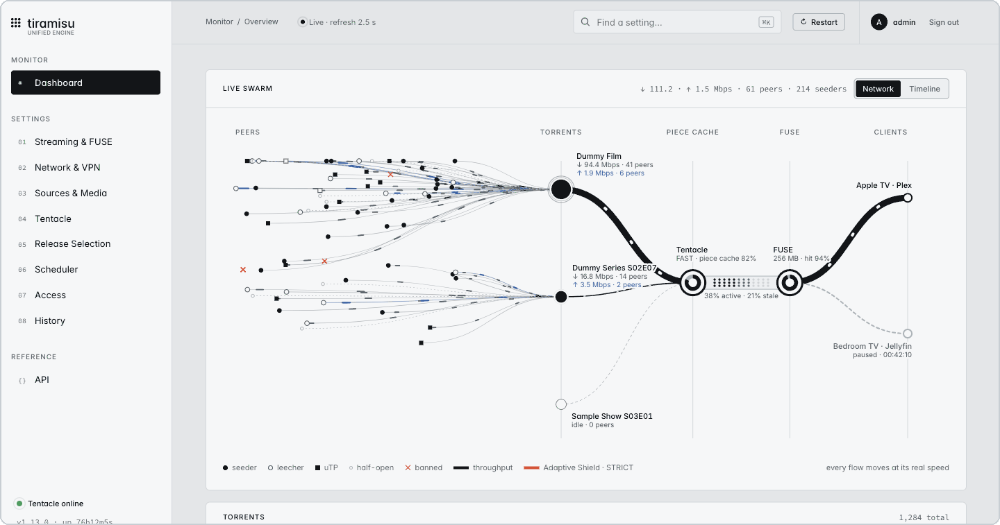
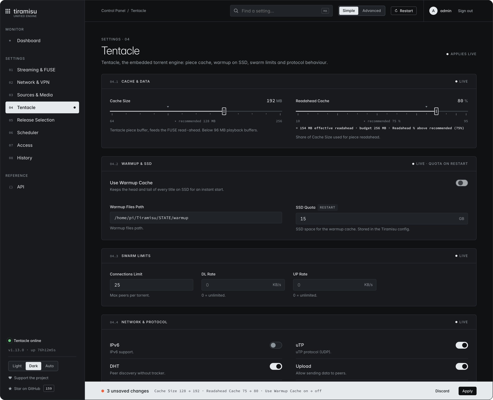
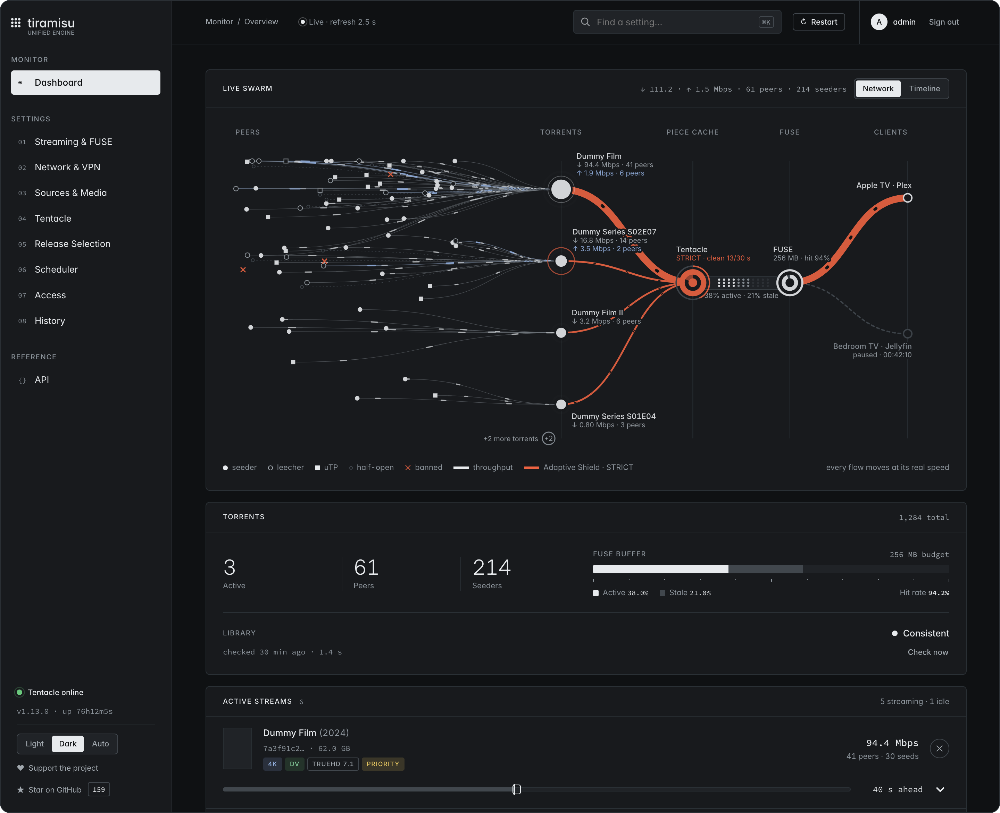
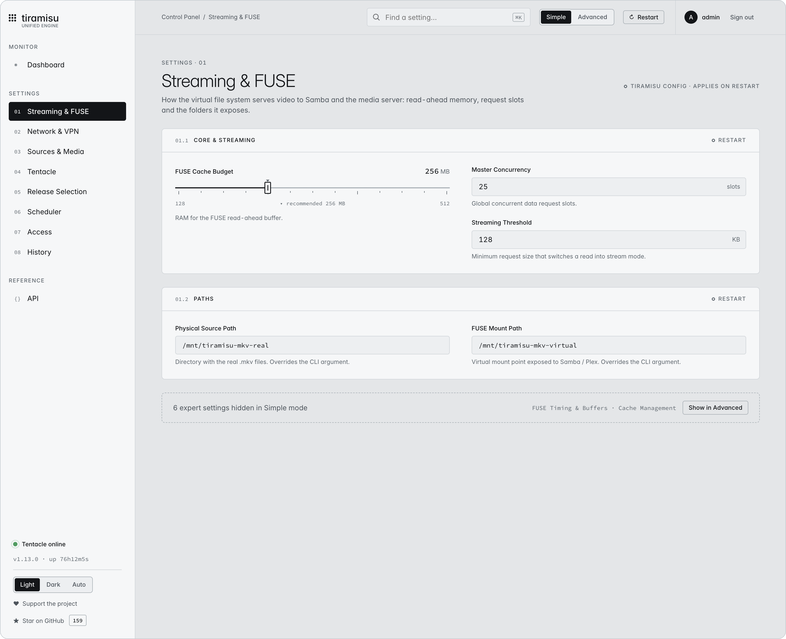
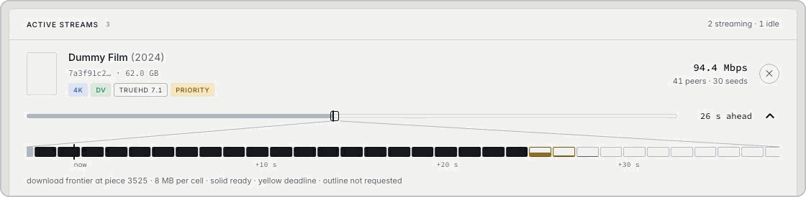
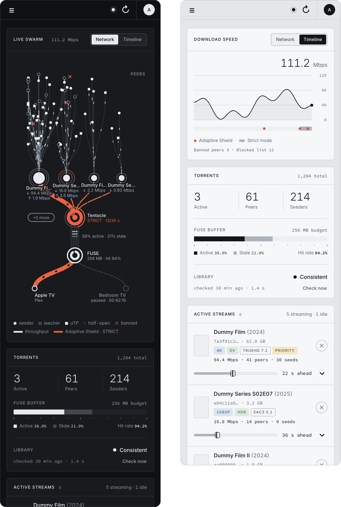
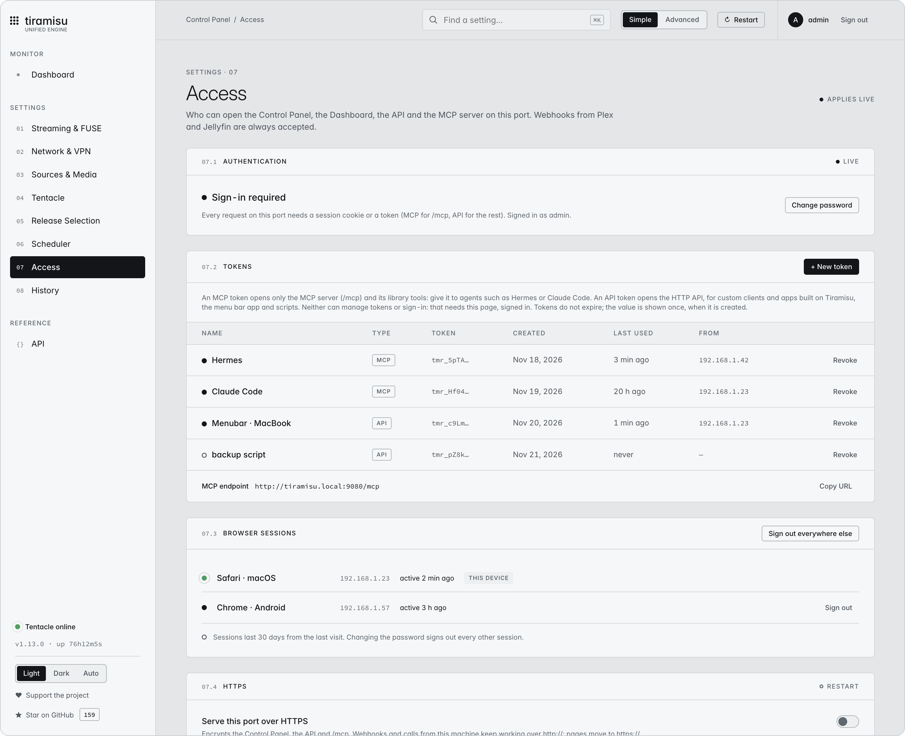
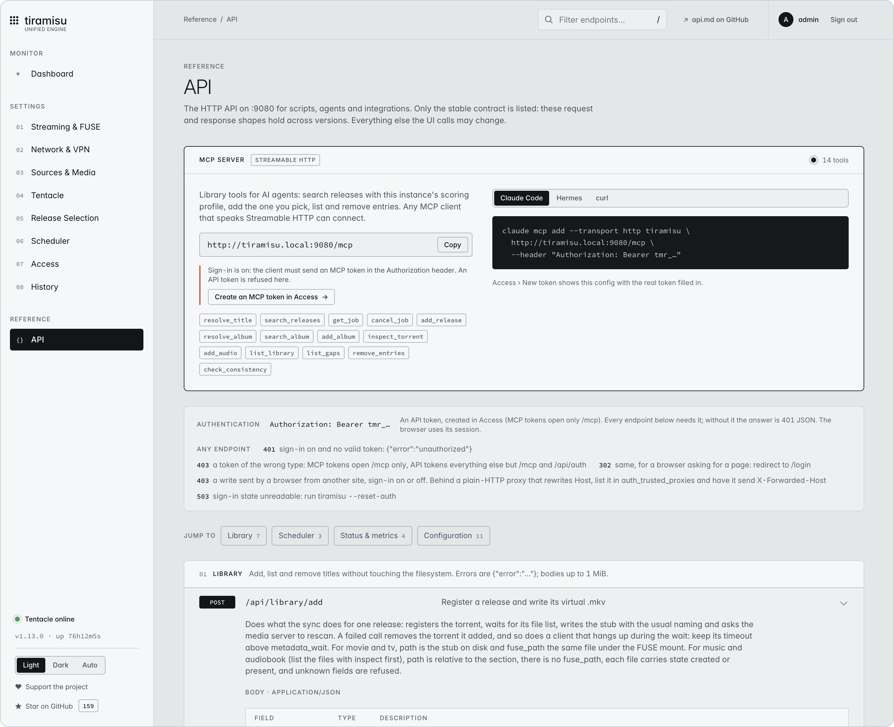

<h1 align="center">
  
</h1>

<p align="center"><strong>BitTorrent engine and FUSE virtual filesystem that streams your torrents to Plex, Jellyfin and Infuse, live.</strong><br>
4K HDR Dolby Vision, fully seekable, starting in under a second, even on a Raspberry Pi 4. MCP ready for Hermes, OpenClaw and Claude Code. No Real-Debrid.</p>

<p align="center">
  <a href="https://github.com/MrRobotoGit/tiramisu/releases/latest"></a>
  <a href="https://hub.docker.com/r/mrrobotogit/tiramisu"></a>
  <a href="https://hub.docker.com/r/mrrobotogit/tiramisu"></a>
  <a href="LICENSE.md"></a>
  <a href="https://github.com/awesome-selfhosted/awesome-selfhosted"></a>
  <a href="https://deepwiki.com/MrRobotoGit/tiramisu"></a>
</p>

<p align="center">
  <a href="#quick-install"><b>Install</b></a> ·
  <a href="#docker"><b>Docker</b></a> ·
  <a href="docs/README.md"><b>Documentation</b></a> ·
  <a href="docs/configuration.md"><b>Configuration</b></a> ·
  <a href="#faq"><b>FAQ</b></a> ·
  <a href="https://github.com/MrRobotoGit/tiramisu/releases"><b>Releases</b></a>
</p>

<p align="center"></p>
<p align="center"><sub>The live swarm: every peer, torrent, cache and player in one graph. When a peer sends bad data, Adaptive Shield lights up the pipes it protects (see Screenshots).</sub></p>

---

## Overview

Tiramisu turns torrents into ordinary, seekable `.mkv` files on a FUSE virtual filesystem. Plex, Jellyfin, Infuse or any player reads them like files on a local disk, while every byte is fetched live from the BitTorrent swarm. Nothing is downloaded in advance, there are no temporary copies and no storage quota.

**Tentacle** is Tiramisu's native torrent engine, built around FUSE. It lets the player lead: every read that reaches a virtual file tells Tentacle which pieces matter next, and it chases them from the swarm against the clock, a few seconds ahead of the scene on screen. A seek moves the whole effort to the new spot at once. Data travels from the peers through RAM to the media server along an in-memory pipe, at the pace the player sets. And when a peer sends bad data, Tentacle shields the picture: it turns strict for that torrent alone, finds the one peer responsible, bans it and carries on.

The result is 4K HDR Dolby Vision playback that starts in under a second from the warmup cache (2–4 s on a cold swarm) and seeks instantly, on hardware as small as a Raspberry Pi 4.

---

## Screenshots

<table>
  <tr>
    <td width="50%"></td>
    <td width="50%"></td>
  </tr>
  <tr>
    <td align="center"><sub><b>Dashboard</b>: speed, torrents, streams, services, scheduler and logs</sub></td>
    <td align="center"><sub><b>Control Panel</b>: every setting, with a change bar that applies them together</sub></td>
  </tr>
  <tr>
    <td></td>
    <td></td>
  </tr>
  <tr>
    <td align="center"><sub><b>Adaptive Shield</b>: a STRICT episode, live</sub></td>
    <td align="center"><sub><b>Light, dark or automatic theme</b></sub></td>
  </tr>
</table>

<p align="center"><br><sub><b>Piece map</b>: under each stream, the pieces from the player's read position to the download frontier, scrolling live</sub></p>

<p align="center"><br><sub>On a phone: the network view fits the first screen</sub></p>

---

## Features

- **Streams, never downloads.** Each `.mkv` is a live torrent with the correct size, fully seekable. Byte ranges pass through RAM and an optional SSD warmup cache for the first and last megabytes of every file.
- **A library that maintains itself.** The built-in sync engine finds new, trending and popular titles on TMDB, picks the best release from Prowlarr or Torrentio, upgrades a 1080p entry to 4K when a better release appears, follows TV series season by season, and adds anything on your Plex Watchlist within the hour.
- **Music and audiobooks too.** `music/` and `audiobooks/` sit next to `movies/` and `tv/`, read-only, with MusicBrainz or ASIN identities, ready for Plex and Plexamp.
- **Playback protection.** Adaptive Shield guards against corrupt data and bans bad peers, TailHedge races a second peer when one stalls, PEXChurn frees slots held by useless peers, and the read-ahead adapts to the bitrate.
- **Native Plex and Jellyfin integration.** Playback webhooks switch the stream to Priority Mode, and titles are matched by IMDb id, so localized names still match.
- **Control Panel and Dashboard.** Every setting in one place, and a live view of the swarm, streams, services, scheduler and logs, on desktop and phone. Each stream shows its piece map: what is ready ahead of the player and where the download frontier is.
- **Library API and MCP server.** Add or remove titles over HTTP, or let an AI agent (Hermes, OpenClaw, Claude Code) search and file releases with your own scoring profile.
- **Optional sign-in.** One user and a password for the Control Panel, the Dashboard and every API, plus named tokens: MCP tokens for AI agents, API tokens for apps and scripts built on Tiramisu. Keys and tokens in the config are write-only.
- **VPN friendly.** NAT-PMP port mapping for WireGuard and an optional IP blocklist, loaded before the engine starts when a cached copy exists.
- **One binary, one port.** Tentacle runs in-process inside the single `tiramisu` binary. The Control Panel, Dashboard, APIs and MCP server all share `:9080`.

---

## Contents

[Overview](#overview) · [Screenshots](#screenshots) · [Features](#features) · [How It Fits Together](#how-it-fits-together-plex-jellyfin-and-infuse) · [Requirements](#requirements) · [Quick Install](#quick-install) · [Docker](#docker) · [Sign-in and Tokens](#sign-in-and-tokens) · [Documentation](#documentation) · [FAQ](#faq) · [Contributing and Security](#contributing-and-security) · [Support](#support) · [Acknowledgements](#acknowledgements) · [License](#license)

---

## How It Fits Together: Plex, Jellyfin and Infuse

> This section explains what you get and how the pieces work together.


**The end result**: you open Infuse on your Apple TV, your entire movie library appears with posters and metadata, you press Play on a 4K Dolby Vision film and it starts in under a second. No buffering. No "downloading...". No subscription to Real-Debrid or any external service. Everything runs on a single board computer or any always-on Linux box in your home.

### How the three pieces fit together

**Tiramisu** runs on your Linux device, a Raspberry Pi, a NAS, a VPS, or any always-on machine. It creates a virtual drive that looks like ordinary storage to the rest of your network: it contains thousands of `.mkv` files, each the correct size, each seekable. In reality, none of those files exist on disk. When anything reads a byte, Tiramisu fetches it in real time from the BitTorrent network and passes it through.

**Plex** (or **Jellyfin**, or any media server) sees this virtual hard drive as a normal media library. It scans the files, downloads posters and descriptions from the internet, tracks what you've watched, and makes everything available on your home network, just like it would with a real NAS.

**Infuse** on Apple TV connects to your Plex/Jellyfin library and plays the files using Direct Play: it reads the video stream directly from the file, with no conversion or re-encoding. This is why it plays 4K HDR Dolby Vision without transcoding, even though the data comes from a torrent in real time.

Because Tiramisu exposes standard `.mkv` files on a standard filesystem, any player or media server that can read a network share works: Plex, Jellyfin, Emby, Kodi, VLC, mpv, or anything else. No plugins, no special configuration.

### How your library gets populated automatically

Tiramisu includes a built-in sync engine that runs on a schedule and keeps your library up to date without any manual intervention.

Every day, the engine queries **TMDB** (The Movie Database) for the latest releases, trending titles, and popular movies. For each title it finds, it searches **Prowlarr** (with Torrentio fallback) for the best available torrent (preferring 4K Dolby Vision, falling back to 1080p). If a good torrent is found, it registers it in the engine and creates the corresponding virtual `.mkv` file in the library.

The next time the media server scans, it finds a new file, downloads the poster and description, and the film appears in your library ready to play.

If a better version of a film becomes available later (for example a 4K HDR release of a title you already have in 1080p), the engine replaces it automatically.

TV series work the same way: the sync engine finds new seasons and episodes, organises them in the Plex/Jellyfin-compatible folder structure (`Show Name (Year)/Season.01/`), and they appear in your library within the week.

You can also add a title to your **Plex Watchlist** from any device and it will appear in your library within the hour.

### 100% local, no subscriptions

Tiramisu has no external dependency at playback time. No third-party service, no monthly fee, no data leaving your home. Your library does not depend on a third-party service at playback time, so it never disappears because a remote service went down.

### When you press Play: the full chain

You tap Play on Infuse, and Infuse asks Plex (or Jellyfin) for the file. Plex
reads it from Tiramisu's virtual filesystem, and at the same time
the media server also fires a webhook at Tiramisu saying "user started playing
this film". Tiramisu matches the event to a torrent and switches that stream to
**Priority Mode**, so every spare byte of bandwidth goes to the film you are
watching and background activity pauses. From there the bytes travel the only
path they ever take: from BitTorrent peers into Tiramisu's memory, through the
FUSE layer to Plex, from Plex to Infuse, and onto the TV. If you seek, the same
machinery jumps straight to the new position in the torrent instead of
re-buffering from the beginning.

---

## Requirements

| Component | Details |
|-----------|---------|
| **Hardware** | Any `linux/amd64` or `linux/arm64` device, **Raspberry Pi 4 is the minimum tested baseline** (4 GB RAM recommended). Runs on NAS, VPS, mini-PC, or any always-on Linux box. **On amd64, AVX2 is strongly recommended** (any x86_64 CPU from ~2013 onward, Intel Haswell or AMD Excavator and later). Without it, Go's SHA1 piece verification falls back to its slowest scalar path and may not sustain real playback bitrates; Tiramisu still starts, logging a warning at boot so high CPU and stuttering have a visible cause. arm64 has no equivalent requirement: NEON is mandatory on every ARMv8-A chip, so any real arm64 device, the Pi 4 included, already clears the floor. |
| **Go** | 1.26+ (`linux/amd64` or `linux/arm64`), do **not** use the 32-bit `linux/arm` toolchain. Build with `CGO_ENABLED=1`: the SQLite piece-completion layer is cgo |
| **FUSE 3** | `sudo apt install fuse3 libfuse3-dev` |
| **systemd** | Native install only, for service management |
| **Samba** | Native install only, to share the library: `sudo apt install samba` |
| **Plex/Jellyfin** | Media Server (on Synology or any network host) |
| **TMDB API key** | For the sync engine. Free at [themoviedb.org](https://developer.themoviedb.org/docs/getting-started) |
| **Plex token** | For the sync engine and webhooks. Settings → Account → XML API |

---

## Quick Install

> [!NOTE]
> Tiramisu was previously called GoStream. The binary name, config paths and systemd service name changed with the rename: when upgrading from a GoStream install, run the install script again to pick up the new layout.

```bash
curl -fsSL https://raw.githubusercontent.com/MrRobotoGit/tiramisu/main/install.sh -o install.sh
chmod +x install.sh
./install.sh
```

The interactive installer handles everything end-to-end:
1. Installs system dependencies (`fuse3`, `libfuse3-dev`, `gcc`, `samba`, `git`)
2. Prompts for all required paths, Plex credentials, TMDB key, and NAT-PMP settings
3. Generates `config.json` from `config.json.example` (fresh installs only: Tiramisu imports it into `STATE/tiramisu.db` on the first start)
4. Creates `Tiramisu/STATE/`, `logs/`, and FUSE mount point directories
5. **Compiles the Tiramisu binary** (downloads Go if needed, detects architecture automatically)
6. Writes and enables the systemd service for `tiramisu`

Once complete:

```bash
sudo systemctl start tiramisu
```

---

## Docker

> [!IMPORTANT]
> Tiramisu mounts a FUSE filesystem at startup. Docker blocks this syscall by default. The container requires elevated privileges to run.

Pre-built images for `linux/amd64` and `linux/arm64` are published automatically on every release to Docker Hub and GitHub Container Registry:

| Registry | Image |
|----------|-------|
| **Docker Hub** | `mrrobotogit/tiramisu:latest` |
| **GHCR** | `ghcr.io/mrrobotogit/tiramisu:latest` |

**Pull:**

```bash
docker pull mrrobotogit/tiramisu:latest
# or
docker pull ghcr.io/mrrobotogit/tiramisu:latest
```

**Run:**

```bash
docker run -d \
  --name tiramisu \
  --restart unless-stopped \
  --device /dev/fuse \
  --cap-add SYS_ADMIN \
  --cap-add NET_ADMIN \
  -v /path/to/state:/state \
  -v /mnt/tiramisu-mkv-real:/mnt/tiramisu-mkv-real \
  -v /mnt/tiramisu-mkv-virtual:/mnt/tiramisu-mkv-virtual:rshared \
  -p 9080:9080 \
  mrrobotogit/tiramisu:latest
```

The full guide covers persistent state in `/state`, updates, mount propagation and the Windows installer: see [Installation → Docker](docs/installation.md#docker).

---

## Sign-in and Tokens

<p align="center"><br><sub><b>Control Panel → Access</b>: sign-in, MCP and API tokens, browser sessions (sample data)</sub></p>

Out of the box, anyone who can reach `:9080` on your network can use the Control Panel, the Dashboard and the APIs. Turn on sign-in in **Control Panel → Access** to require a password for all of them: the Control Panel, the Dashboard, every `/api/*` endpoint, `/metrics` and the MCP server.

- **One user, one password.** A browser stays signed in for 30 days from its last visit. The Access page lists the signed-in browsers and can sign out all the others.
- **Two kinds of token for everything that is not a browser.** Each client gets a named token (`tmr_…`), sent as `Authorization: Bearer <token>`. An **MCP token** opens only the MCP server and its library tools: give it to AI agents such as Hermes or Claude Code. An **API token** opens the HTTP API: give it to any software built on top of Tiramisu, such as a custom client or app that adds and removes titles, reads the engine status or starts a sync, the macOS menu bar app and your scripts. Neither can create or revoke tokens, change the password or turn sign-in off: that takes the Control Panel, signed in. Tokens do not expire; the value is shown once, when you create it, and you can revoke it at any time from the same page.
- **Create the tokens first.** Tokens can be created while sign-in is still off: configure your clients, then turn it on, and nothing stops working.
- **Plex and Jellyfin keep working.** Their playback webhooks stay open, so the media server needs no changes.
- **Keys stay on the server.** Your Plex/Jellyfin token and your TMDB and Prowlarr API keys are write-only: the Control Panel shows whether each one is set, never its value.
- **One door.** The engine runs in-process and has no HTTP port of its own: torrents are managed only through `:9080`, behind sign-in.

```bash
# An MCP client (Claude Code) with an MCP token
claude mcp add --transport http tiramisu http://<host>:9080/mcp \
  --header "Authorization: Bearer tmr_..."

# A script with an API token
curl -H "Authorization: Bearer tmr_..." http://<host>:9080/api/health
```

**HTTPS.** `:9080` can also encrypt everything itself: **Control Panel → Access → HTTPS**. Tiramisu creates a local CA valid for 10 years; each device trusts it once (download `tiramisu-ca.crt` from the same card), and the server certificate it signs renews on its own. Plain HTTP keeps working for the Plex and Jellyfin webhooks and for calls from the host itself; pages move to `https://`, and with sign-in on the API refuses plain HTTP from the LAN. Your own certificate works too. With HTTPS on, use `https://<host>:9080` in the examples above and point the client at the CA (`curl --cacert`, `NODE_EXTRA_CA_CERTS`): see [HTTPS](docs/api.md#https).

**Forgot the password?** Stop the service, run `tiramisu --reset-auth` on the host, start it again: the user, the sessions and the tokens are cleared and sign-in is off. With Docker, start the container once with `-e TIRAMISU_RESET_AUTH=1`, then remove the variable.

Every endpoint is documented inside Tiramisu too: **Reference → API** in the side menu (`/api-docs`) lists the stable API with parameters, a ready-to-copy `curl` for your own address and sample responses, and puts the MCP server address first.

<p align="center"><br><sub><b>Reference → API</b>: the MCP server and the HTTP endpoints, documented in the app</sub></p>

Sign-in is meant for your home network, with Tiramisu's own HTTPS or a reverse proxy in front of it; see [Sign-in and API tokens](docs/api.md#sign-in-and-api-tokens) and [HTTPS](docs/api.md#https) for the details: rate limits, reverse proxies, certificates and what happens if the state database cannot be read.

---

## Documentation

| Guide | What it covers |
|-------|----------------|
| [Installation](docs/installation.md) | Docker in detail, Plex/Jellyfin and Samba setup, building from source |
| [User Guide](docs/user-guide.md) | First-run steps, webhooks, the Control Panel and the Dashboard |
| [Sync Engine](docs/sync-engine.md) | Movies, TV, Watchlist and Music sync, the dead-release reaper, Prowlarr |
| [Configuration](docs/configuration.md) | Where the configuration lives, every field, history and import, quality scoring, languages, environment variables |
| [API and MCP Server](docs/api.md) | Sign-in and API tokens, HTTPS, Library API, MCP server for AI agents, HTTP endpoint reference |
| [Architecture](docs/architecture.md) | How the FUSE layer, caches and engine work; performance figures |
| [Troubleshooting](docs/troubleshooting.md) | Common problems and fixes, file locations |

---

## FAQ

**What is Tiramisu?**
Tiramisu is a self-hosted BitTorrent engine with a built-in FUSE virtual filesystem. It presents torrents as normal, seekable `.mkv` files to Plex or Jellyfin, and streams the bytes live from the swarm as they are read, with no download step and no temp files.

**How is this different from Real-Debrid or other debrid services?**
Debrid services are third-party paid subscriptions that cache torrents on someone else's servers and hand you an HTTP link. Tiramisu runs entirely on hardware you own, no subscription, no third-party server, no monthly fee. You get the same "instant playback" experience, but the BitTorrent swarm itself is the source, not a rented cache.

**Does Tiramisu store or download the files?**
No persistent copy of the media is kept. Byte ranges pass through RAM (and an optional bounded SSD cache limited to the first/last few MB of each file, purely to speed up the first seconds of playback) and are never written to disk as complete files. There is no storage quota to plan around because there is nothing to store.

**Do I need to seed or keep uploading?**
Tiramisu participates in the swarm like any BitTorrent client while a file is open, but retention drops automatically once playback stops, and no long-term seeding is required or expected.

**What hardware do I need?**
A Raspberry Pi 4 (4 GB RAM) is the tested minimum baseline, and it comfortably handles 4K HDR streaming. Any `linux/amd64` or `linux/arm64` machine works: NAS, VPS, mini-PC, or any always-on Linux box.

**Does it work with Sonarr, Radarr, or other *Arr tools?**
Not directly. Tiramisu has its own built-in sync engine that talks to TMDB, Prowlarr, and Torrentio to discover and add titles automatically, so it does not need the *Arr suite to function. There is currently no compatibility layer for those tools specifically.

**Is this legal?**
Tiramisu is a general-purpose BitTorrent engine and streaming filesystem. It does not host, index, or distribute any copyrighted content itself; what you do with it is your responsibility, same as with any BitTorrent client.

**Can I put Tiramisu on the internet?**
Not directly. Turn on sign-in and HTTPS (Control Panel → Access), or put a reverse proxy with HTTPS in front of `:9080`; for access from outside your home a VPN (WireGuard, Tailscale) is safer than an open port.

**Is my data private?**
Everything runs on your own hardware. No account, no third-party API key is required for the core engine to work (TMDB, Prowlarr, and Plex/Jellyfin integrations are optional and use your own credentials).

---

## Contributing and Security

Contributions are welcome: read [CONTRIBUTING.md](CONTRIBUTING.md) before opening a pull request. To report a vulnerability, follow [SECURITY.md](SECURITY.md) instead of opening a public issue.

---

## Support

Tiramisu is free and open source. If it is useful to you, you can support its development through GitHub Sponsors.

[](https://github.com/sponsors/MrRobotoGit)

---

## Acknowledgements

Tiramisu builds on [anacrolix/torrent](https://github.com/anacrolix/torrent), embedded as a patched fork. Its engine began as a fork of [TorrServer](https://github.com/YouROK/TorrServer); since v1.13.0 Tentacle, Tiramisu's own engine, has replaced it.

The optional peer country and network view uses the DB-IP Lite databases: [IP geolocation by DB-IP](https://db-ip.com), licensed under [CC BY 4.0](https://creativecommons.org/licenses/by/4.0/).

---

## License

GNU General Public License v3.0. See [LICENSE.md](LICENSE.md).
